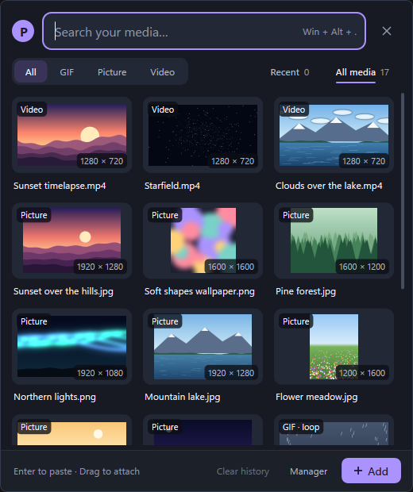
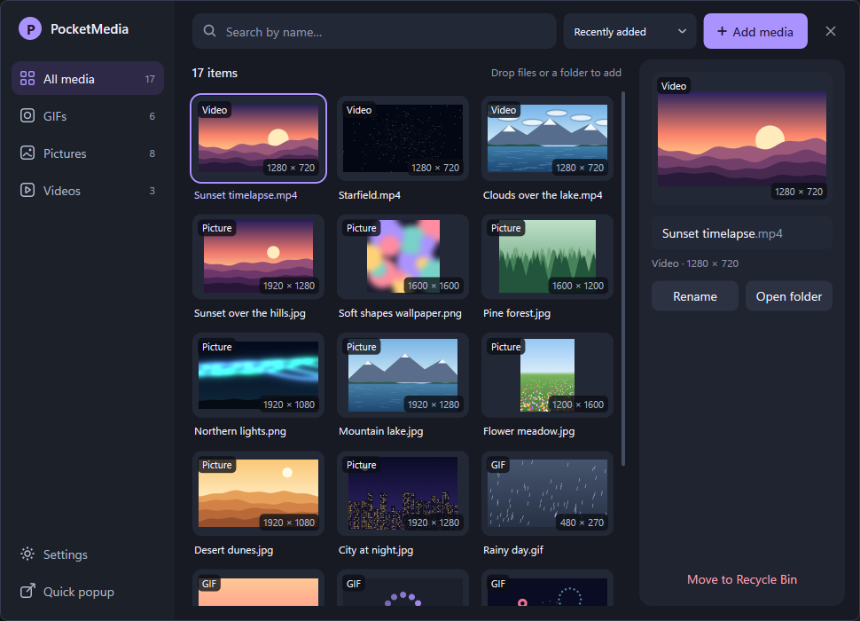
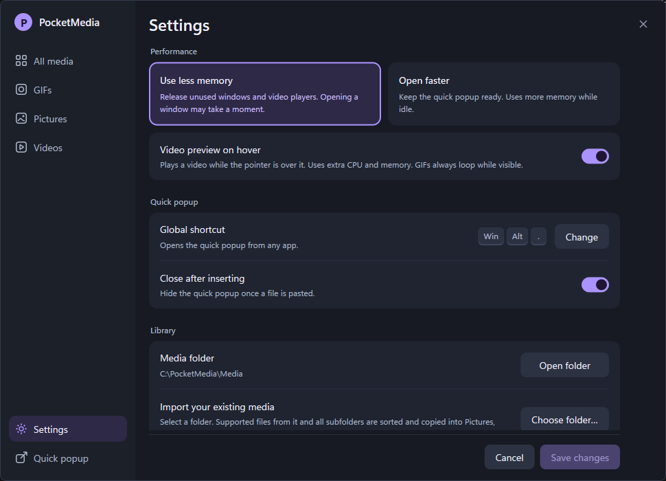

# PocketMedia

PocketMedia is a small Windows tray app for your own GIFs, pictures and videos. Press a shortcut in any app, type part of a file name and press Enter, and the file is pasted into the app you were in.







## Download and install

- Download `PocketMedia-Setup-1.0.0.exe` from the [Releases page](https://github.com/Wambo420Rambo/PocketMedia/releases) and run it.
- **Needs Windows 11, 64-bit (Intel or AMD).** Setup refuses Windows 10, Arm64 and 32-bit Windows.
- **The installer is not signed**, so Windows SmartScreen may warn you. Click **More info**, then **Run anyway**. Each release lists the file's SHA-256 checksum, so you can check your download.
- Setup asks how PocketMedia should behave (see [Settings](#settings-that-matter)), whether to start it with Windows, and where to install it (default `C:\PocketMedia`).

## How to use it

- **Open the quick popup:** press **Win + Alt + .** in any app. You can also left-click the tray icon. Press the shortcut again or Escape to close it.
- **Tray icon:** right-click it for **Quick popup**, **Open manager**, **Settings** and **Exit**. Closing a window only hides it. PocketMedia keeps running in the tray until you choose Exit.
- **Search:** just type. Every word you type must appear in the file name, in any order: `dance happy` finds `Happy dance.gif`. Use **All / GIF / Picture / Video** to narrow it down, and switch between **All media** (where the popup always opens) and **Recent**.
- **Paste:** click a tile, or press Enter. PocketMedia pastes the original file into the app you were in (Discord, Slack, a browser…).
- **Drag out:** drag a tile into any app or folder that accepts files. This always copies; it never moves your file.
- **Add media:** click **Add** in the popup or **Add media** in the Manager. Choose files or a folder (with its subfolders), or drop them on the window. You see a list first, where you can rename files. Identical files are skipped, and a different file with the same name gets a new name like `name (2).gif`. PocketMedia copies the files into its own Media folder; your originals stay where they are.
- **Manager:** browse everything, rename, open the file's folder, or move a file to the Recycle Bin.

**Supported formats:** `.jpg` `.jpeg` `.png` `.gif` `.mp4`

## Settings that matter

- **Use less memory** or **Open faster** (you choose in Setup, and can change it later):
  - **Use less memory** frees the windows and picture workers while they are hidden. PocketMedia stays very small in the tray, but the popup takes a moment longer to open (about 0.14 s instead of 0.02 s).
  - **Open faster** keeps the popup ready, so it opens almost instantly, but PocketMedia uses more memory while it waits in the tray.
- **Global shortcut:** click **Change** to pick another shortcut. PocketMedia tells you if Windows or another app already uses it.
- **Autostart PocketMedia:** starts PocketMedia quietly in the tray when you sign in.
- **Back up library:** copies all your media and the library to a folder you choose, and checks the copies.
- Also: video preview on hover (on or off), close the popup after pasting, open the Media folder, import your existing media.

## Performance

Measured from outside the app on the packaged build of PocketMedia (the 1.0.0 code), installed by Setup. Memory means private memory, which is what Task Manager's "Memory" column shows. Each range covers every measured pass, with an empty and with a filled thumbnail cache: three runs for 350 files and one shorter run for 200 and 1,000 files.

| | 200 files (0.42 GB) | 350 files (0.75 GB) | 1,000 files (2.23 GB) |
|---|---|---|---|
| **Use less memory** | | | |
| In the tray, after start | 2.5–2.6 MiB | 2.7–2.8 MiB | 3.7 MiB |
| In the tray, after using the popup | 15–16 MiB | 14–19 MiB | 16–18 MiB |
| In the tray, after using the Manager | 15–17 MiB | 15–22 MiB | 16–21 MiB |
| Popup: first open / opening again | 0.19–0.20 s / 0.14 s | 0.18–0.21 s / 0.14–0.15 s | 0.18–0.20 s / 0.13–0.14 s |
| **Open faster** | | | |
| In the tray, after start | 3.2 MiB | 3.4–3.5 MiB | 4.5–4.6 MiB |
| In the tray, after using the popup | 71–73 MiB | 77–88 MiB | 88–89 MiB |
| In the tray, after using the Manager | 79–81 MiB | 81–164 MiB | 83–91 MiB |
| Popup: first open / opening again | 0.17–0.18 s / 0.02 s | 0.17–0.20 s / 0.02 s | 0.17–0.18 s / 0.02–0.03 s |
| **Both** | | | |
| Manager opens | 0.16–0.17 s | 0.16 s | 0.16 s |
| CPU while idle in the tray | 0 % | 0–0.003 % | 0–0.005 % |

- "Opening again" is the median time until the first nine pictures show. "First open" is the first open after a start, until the window is drawn.
- With Open faster, the memory used to show large photos in the Manager can stay with PocketMedia afterwards. That is why the "after using the Manager" range is wide.
- The test machine: AMD Ryzen 7 7800X3D, 32 GB, Windows 11 25H2, 2560 x 1440 at 100 %. The libraries mix 12-megapixel photos, screenshots, GIFs and 720p/1080p videos.

## Privacy

PocketMedia never connects to the network. It has no update check, no telemetry and no crash reporting, and it contains no code that opens a network connection. It only reads and writes files on your computer: its own folder, and the files and folders you choose (Add media, Back up library, drag and paste).

## Where your data is kept

Everything lives in the install folder (default `C:\PocketMedia`):

- `Media\Pictures`, `Media\GIFs`, `Media\Videos`: your copies of the media.
- `Data\pocketmedia.json`: the library, your settings and the Recently used list, plus a backup copy.
- `Cache`: small thumbnails (at most 128 MiB). It is rebuilt when needed.

Autostart is one entry in your account's Windows startup list (`HKCU\...\Run`, named PocketMedia). Updating to a newer version keeps all media, settings and history.

## Uninstall

Open **Windows Settings → Apps → Installed apps → PocketMedia → Uninstall**.

- **Uninstalling deletes your Media folder and every file in it**, plus Data, Cache and the Autostart entry. Nothing of the library stays.
- Back up first: the uninstaller has a **Back up library…** button (the same as in Settings).
- You must type **CONFIRM** (in capitals) before anything is deleted. Anything that could not be removed is listed at the end.
- Files in the folders you originally imported from are never touched.

## Known limitations

- **Slow drives:** PocketMedia saves its library file in the window's own thread. On a slow USB stick or network drive, the window can pause for a moment after a paste, rename or import.
- **Start-up:** at start, PocketMedia compares its library with the Media folder before the tray icon appears. A big library makes this take a little longer.
- **Many GIFs:** each redraw of the popup searches the whole library, also while GIFs animate. With a very large library, that costs a little more CPU.
- **Built-in self-test:** the program file also contains PocketMedia's own test code, which makes it about 2.3 MB. It only runs when started with `--self-test`.
- **Pasting:** PocketMedia can start a paste, but it cannot know whether the other app accepted or uploaded the file. If an app does not take a paste, drag the tile instead.
- **No automatic updates:** to update, download and run the newer installer.

## Build from source

You need Windows 11 x64, [Rust](https://rustup.rs) (stable, MSVC toolchain; 1.0.0 was built with Rust 1.99) and the Visual Studio C++ Build Tools.

```
cargo build --release
```

This makes `target\release\pocketmedia.exe`. PocketMedia keeps its Media, Data and Cache folders beside the exe, so a copy started from there gets its own library in `target\release`.

For the installer, install [Inno Setup](https://jrsoftware.org/isdl.php) 6.3 or newer, then run:

```
ISCC installer\pocketmedia.iss
```

This makes `installer\Output\PocketMedia-Setup-1.0.0.exe`.

## License

[IDGAFPL](LICENSE.md)
